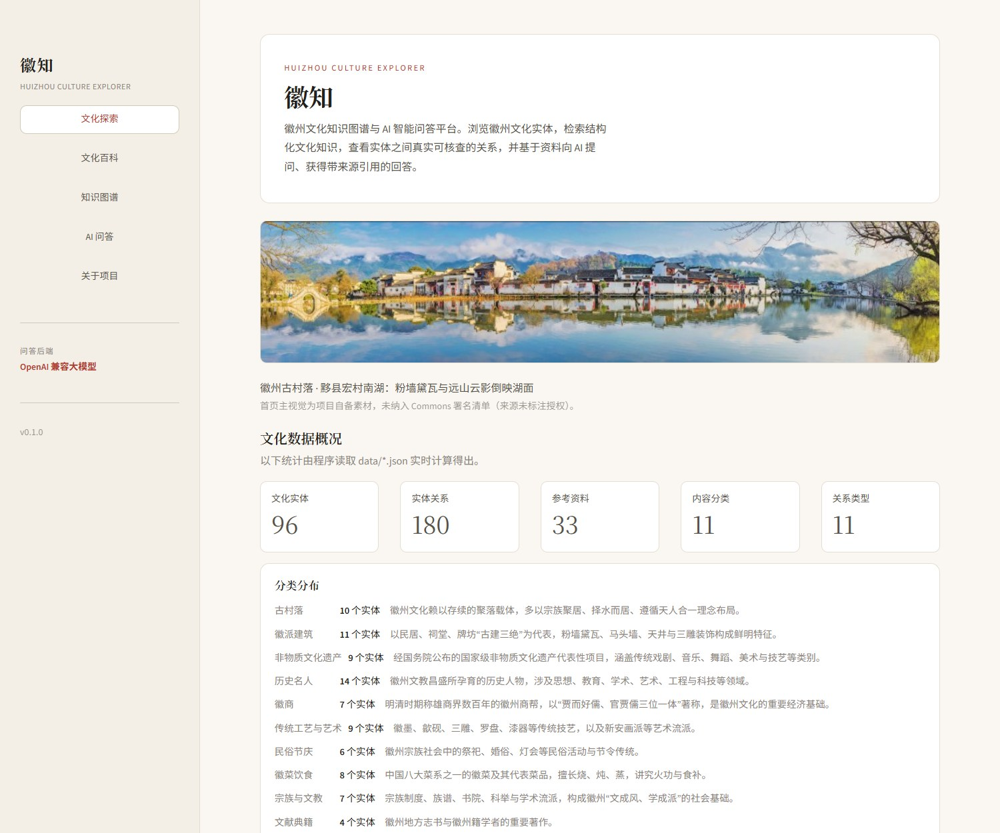
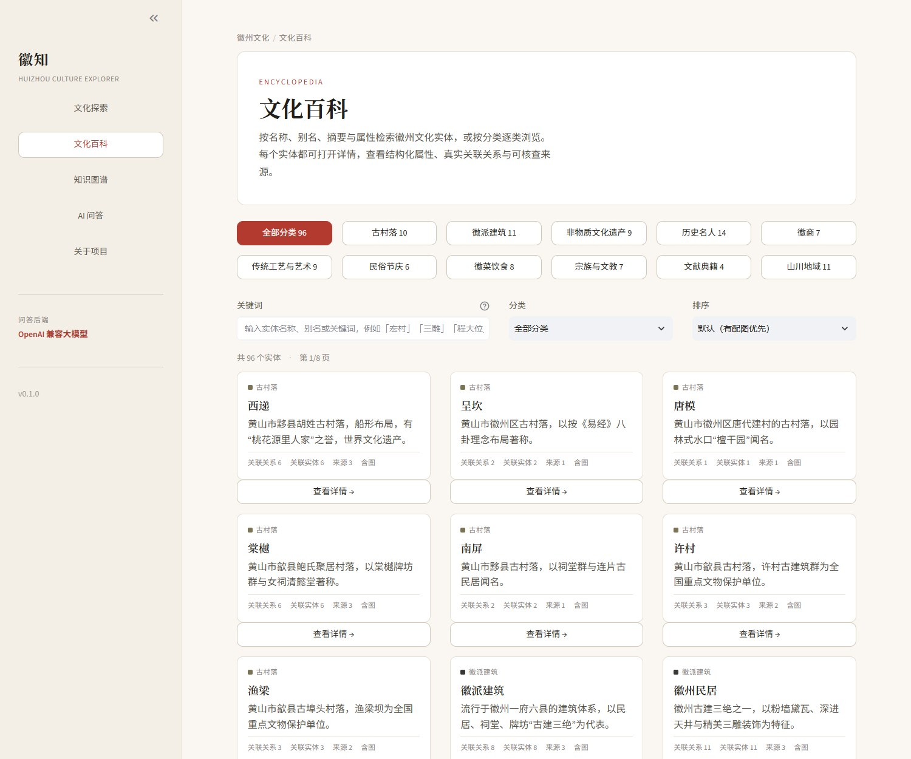
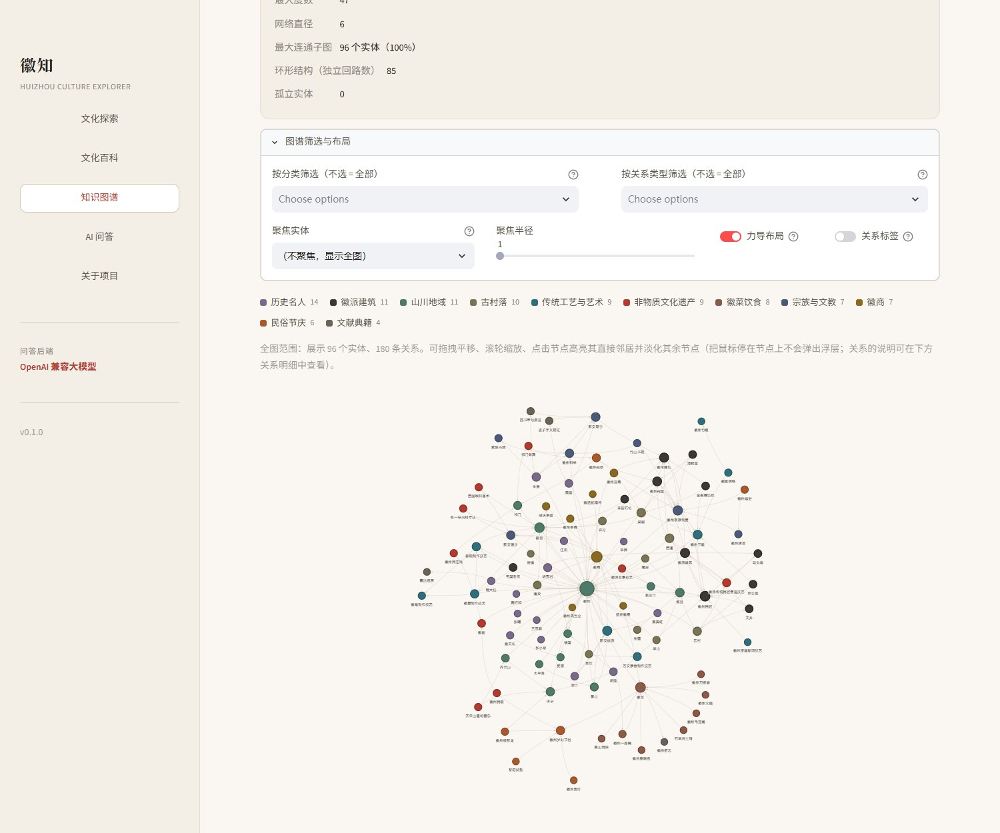
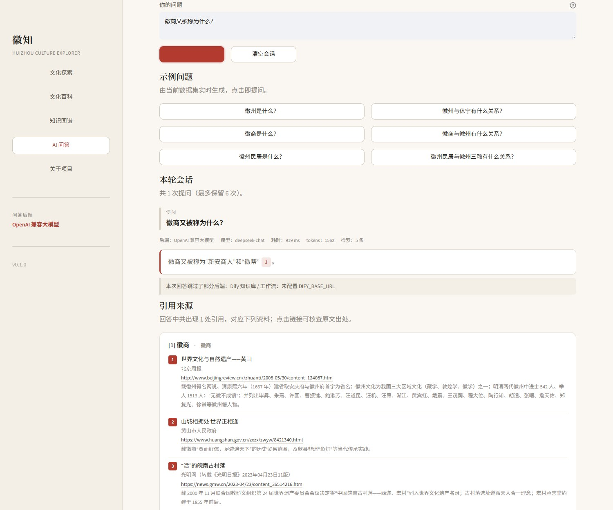
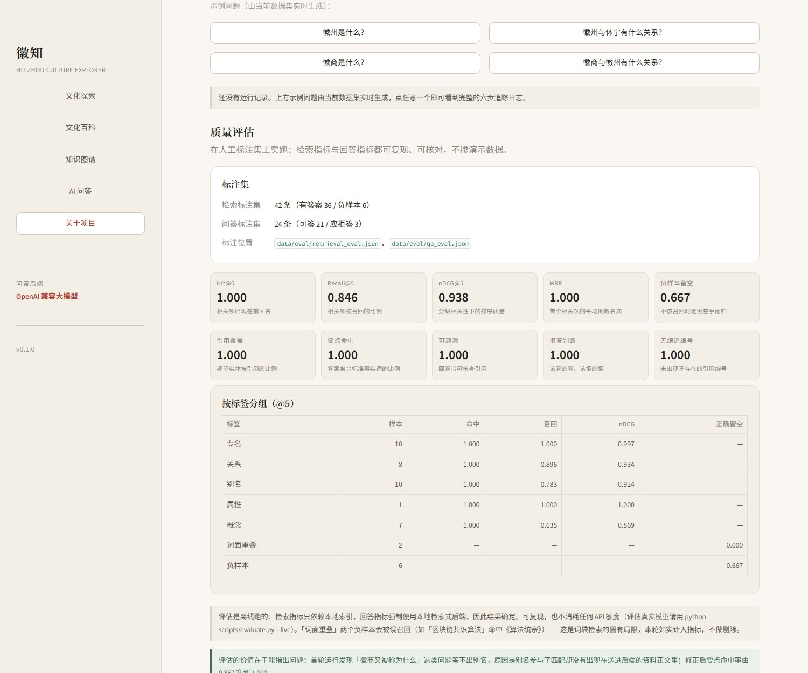
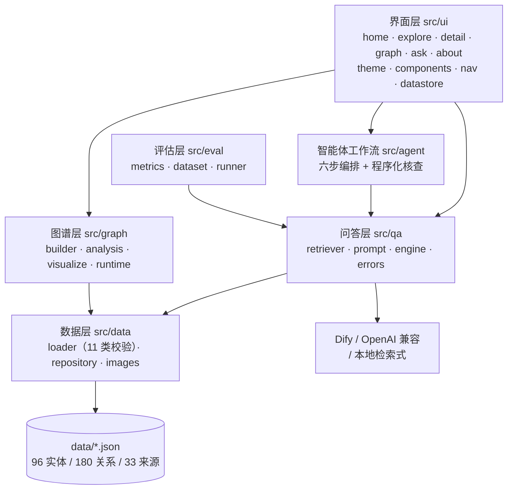
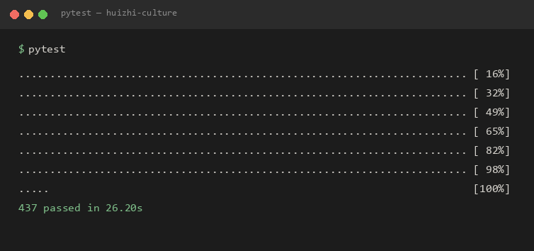

# 徽知 · Huizhou Culture Explorer

[](https://github.com/ttc6642728/huizhi-culture/actions/workflows/tests.yml)


<!-- 仓库名不叫 huizhi-culture 时，把上面 CI 徽章里的两处路径改掉即可 -->

> **一句话定位**：把徽州文化整理成**可查询、可追溯**的知识图谱，并让 AI 严格依据本地资料作答、
> 逐句标注来源——一个不只「能跑」、还能**被评估**的中文 RAG 应用。

## 项目背景

徽州文化（一府六县：歙县、休宁、黟县、祁门、绩溪、婺源）的资料散落在方志、名录与百科里，
彼此之间「谁属于谁、谁师承谁、哪项非遗申报在哪个县」的关系只能靠人脑串。这个项目想解决两件事：

1. **把关系说清楚**——用知识图谱建模实体之间的关系，而不是又一份百科列表；
2. **让 AI 的回答可信**——检索不到就明说，每个事实都标编号，编号能点回原文。

它最初是「生成式 AI 与智能体开发」课程设计，之后按**可交付**的标准重做了数据层、把检索与作答
拆成可分别评估的两层、补上人工标注的质量评估，并把真实踩过的坑写进开发文档。
完整过程见 [`docs/PROJECT_REPORT.md`](docs/PROJECT_REPORT.md)。

---

## 功能

| 能力 | 说明 |
|---|---|
| 文化百科 | 名称 / 别名 / 摘要 / 属性加权检索，11 分类筛选，每页 12 条，有配图的默认靠前 |
| 实体详情 | 结构化属性、正文、关联关系**按方向分组**（`→` 出向，`←` 入向用反向名称），来源可点击 |
| 知识图谱 | 96 节点 / 180 边的 `MultiDiGraph`，可筛选、聚焦子图、点选高亮、查任意两实体最短路 |
| 图谱分析 | 度数 / 介数中心性、连通分量、直径、模块度聚类 |
| AI 问答 | 三层后端自动降级（Dify → OpenAI 兼容 → 本地检索式），回答标注 `[n]` 引用，越界编号标红 |
| 智能体工作流 | 解析 → 检索 → 作答 → 核查 → 纠正 → 归档，六步留痕，失败写明停在哪一步 |
| 质量评估 | 42 条检索标注 + 24 条问答标注，Recall@K / nDCG@K / MRR / 要点命中，可离线复现 |
| 数据校验 | 11 类检查，**每条实体与关系都必须有来源**，无来源不入库 |

### 界面



*文化探索：首页主视觉、数据概况与分类构成，数字全部由 `data/*.json` 实时计算。*



*文化百科：11 个分类筛选，卡片直接标出关联关系数与来源数。*



*知识图谱：节点按分类着色，配色与百科页、详情页共用同一套定义。*



*AI 问答：回答里的 `[1]` 指向下方「引用来源」，只列真正被引用到的资料，可点开核查原文。*



*关于项目：可现场运行的六步工作流，以及在人工标注集上实跑出的检索 / 回答指标。*

> 截图取自本机真实运行。没有配置 `.env` 时问答走本地检索式后端，引用与来源结构一致，
> **不需要任何 API Key**。

---

## 技术栈

| 层 | 选型 | 为什么 |
|---|---|---|
| 界面 | Streamlit 1.66 | 纯 Python 出交互界面，样式用注入 CSS 控制，不加前端构建链 |
| 图谱 | NetworkX 3.7 `MultiDiGraph` | 数据里存在同向平行边，`DiGraph` 会静默丢边 |
| 可视化 | PyVis 0.3.2 + 自研清洗 | 产物需**完全离线自洽**，模板自带的外链必须剥掉 |
| 检索 | jieba + 自写 BM25 | 中文分词 + 精确命中加成；不引入向量库，保持零外部服务 |
| 生成 | Dify / OpenAI 兼容 / 本地检索式 | 三级降级，没有 Key 也能完整使用 |
| 测试 | pytest 9.1，437 个用例 | 全程不联网、不读 `.env`、不消耗额度 |
| CI | GitHub Actions | Python 3.12 / 3.13 双版本 |

---

## 架构



界面不写业务逻辑：每个页面只做展示，检索、建模、作答都在下层，因此可以脱离 Streamlit 单独测试。
`src/eval/` 只依赖「一个检索器」和「一个引擎」两个接口，不 import 界面，所以换界面不用改评估。

---

## 快速开始

### 环境要求

- **Python 3.12 或更高**（开发环境 3.13.14）
  > 下限由依赖决定：`networkx 3.7` 与 `numpy 2.5` 要求 ≥ 3.12，`streamlit 1.66` 要求 ≥ 3.11。
  > 用 3.10 / 3.11 会在依赖解析阶段直接失败。
- 首次安装依赖需要联网（约 150–250 MB），装好后运行不再联网。
- Windows / macOS / Linux 均可。

### 安装

```bash
git clone https://github.com/ttc6642728/huizhi-culture.git
cd huizhi-culture
python -m venv .venv
source .venv/bin/activate          # Windows: .venv\Scripts\activate
pip install -r requirements.txt
```

国内网络建议加镜像：`-i https://mirrors.aliyun.com/pypi/simple/`

### 运行

```bash
streamlit run app.py
```

浏览器打开 `http://localhost:8501`。**不需要任何配置**——没有 `.env` 时问答自动降级到本地检索式后端。

想启用真实大模型：`cp .env.example .env`，任选其一填写（`.env` 已被 gitignore）：

| 后端 | 需要的键 |
|---|---|
| 自建 Dify 知识库 / 工作流 | `DIFY_BASE_URL`、`DIFY_API_KEY`（可选 `DIFY_APP_TYPE`） |
| 任意 OpenAI 兼容接口（DeepSeek / 通义 / 智谱 …） | `LLM_BASE_URL`、`LLM_API_KEY`、`LLM_MODEL` |

### 测试

```bash
pytest                             # 437 个用例，约 30 秒，全程不联网
python scripts/validate_data.py    # 数据校验（来源完整性等 11 类检查）
python scripts/evaluate.py         # 离线质量评估，--verbose 看未命中明细
```

---

## 测试



437 个用例全部通过，无警告。整套测试**不联网、不读 `.env`、不消耗任何 API 额度**：
问答与工作流用例强制本地后端并注入假 HTTP，评估用例固定离线运行。

覆盖范围：数据校验与查询仓储、图谱建模与分析、离线可视化自洽性、导航路由、图片库降级与
抓取把关、界面组件与冒烟测试（真实点击按钮验证跳转）、界面结构快照、检索排序与三层降级、
工作流步骤顺序与失败中止、评估指标计算。详见 [`docs/TEST_REPORT.md`](docs/TEST_REPORT.md)。

> 界面回归只做到**结构层**（`tests/snapshots/`，排除样式块），不宣称像素级视觉回归。

---

## 目录结构

```
huizhi-culture/
├─ app.py                   Streamlit 入口：页面配置、侧边栏导航、路由
├─ requirements.txt · pytest.ini · .env.example · LICENSE
├─ src/
│  ├─ config.py             路径、环境变量、问答后端探测
│  ├─ data/                 loader（模型 + 11 类校验）· repository · images
│  ├─ graph/                builder · analysis · visualize · runtime
│  ├─ qa/                   retriever（BM25）· prompt · engine（三层降级）· errors
│  ├─ agent/workflow.py     六步编排、引用核查、纠正重试
│  ├─ eval/                 metrics（纯函数）· dataset（严格校验）· runner
│  └─ ui/                   theme · components · nav · datastore · pages/
├─ data/                    实体 / 关系 / 来源（JSON）+ eval/ 人工标注集
├─ assets/images/           15 张 CC 授权图片 + manifest.json + CREDITS.md
├─ scripts/                 validate_data · graph_report · evaluate · fetch_images
├─ tests/                   16 个模块 / 437 个用例 + snapshots/ 结构基线
├─ docs/                    开发文档、测试报告、数据来源、部署说明、截图
└─ .github/workflows/       CI：3.12 / 3.13 双版本跑测试与数据校验
```

---

## 已知问题与后续规划

这一节如实记录边界，不粉饰。

| # | 已知问题 | 现状与原因 |
|---|---|---|
| 1 | **召回是瓶颈**：概念类 Recall@5 = 0.635 | 以「实体」为唯一检索粒度，多实体问法（如「徽菜代表菜品」有 7 个答案）在 top-5 里只能覆盖一部分 |
| 2 | 2 条词面重叠负样本**必然误召回** | 「区块链共识算法」命中《算法统宗》、「Python 装饰器」命中承志堂（描述里有「装饰」）；BM25 词袋固有局限，**单独打标签统计，不剔除** |
| 3 | 图片只覆盖 15/29 个实体 | 收录门槛是「自由授权 + 确实相关 + Commons 登记了作者」三条同时满足，宁可缺图也不放错图 |
| 4 | Dify 后端未连真实服务 | 只用本地假实例走完整 HTTP 路径验证协议；OpenAI 兼容后端已实测 DeepSeek |
| 5 | 样式退化无人看守 | 界面回归只到结构层，没有像素级对比 |
| 6 | 无用户系统、不落库 | 问答历史存在 `st.session_state`，刷新即清空 |
| 7 | 首页主视觉无授权信息 | 项目自备素材，界面已如实声明「未纳入 Commons 署名清单」 |

**后续规划**（按收益排序）

1. **检索改成关系三元组级检索单元**：现在的资料粒度是实体，概念类查询答不全，拆到三元组才能根治。
2. **数据扩到 200+ 实体**，优先补 B 级来源（国家级非遗名录、国保单位）覆盖的文化要素。
3. **混合检索**：BM25 之上加一层向量召回，针对别名与近义表述；评估集已就位，可直接量出增益。
4. **视觉回归**：把截图对比接进 CI，锁住这次修掉的按钮对比度一类问题。
5. 评估引入 LLM-as-judge 作**对照**（人工标注仍是基准）。

---

## 文档

| 文档 | 内容 |
|---|---|
| [`docs/PROJECT_REPORT.md`](docs/PROJECT_REPORT.md) | 项目开发文档：需求、设计、分阶段记录、问题与总结 |
| [`docs/DEVELOPMENT.md`](docs/DEVELOPMENT.md) | 架构决策与取舍理由（24 条）、模块职责、数据模型 |
| [`docs/TEST_REPORT.md`](docs/TEST_REPORT.md) | 逐阶段测试记录、437 用例分布、遗留问题收敛表 |
| [`docs/DATA_SOURCES.md`](docs/DATA_SOURCES.md) | 数据来源分级（A–E）、核实方式 |
| [`docs/DEPLOY.md`](docs/DEPLOY.md) | Streamlit Cloud 部署、打包交付、GitHub 仓库设置 |

---

## 许可证

代码以 **MIT** 发布，见 [`LICENSE`](LICENSE)。

`assets/images/` 下的徽州文化图片来自 Wikimedia Commons，各自遵循 CC BY-SA 等自由许可，
逐张署名见 [`assets/images/CREDITS.md`](assets/images/CREDITS.md)；首页主视觉
`hero_hongcun_nanhu.jpg` 为项目自备素材、未标注许可，不在自由许可范围内。
文化数据来源见 [`docs/DATA_SOURCES.md`](docs/DATA_SOURCES.md)。
